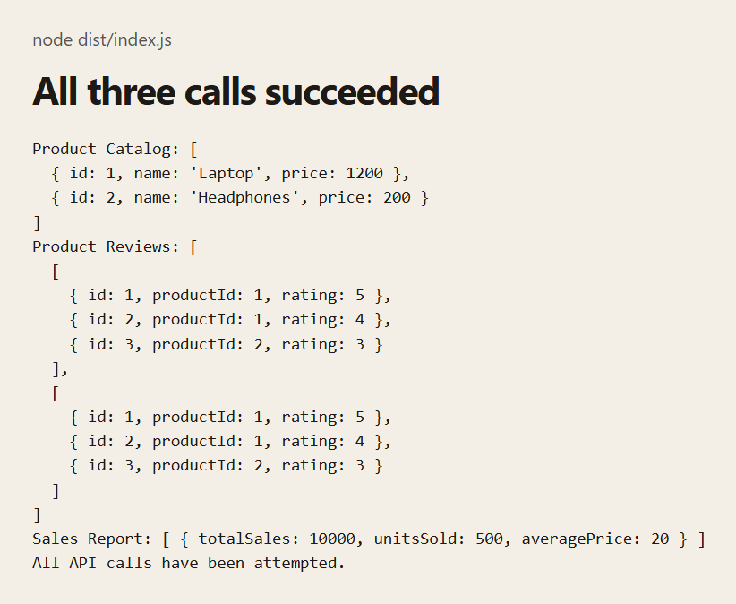
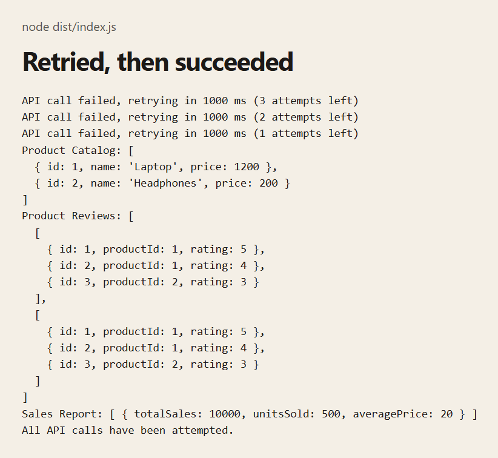
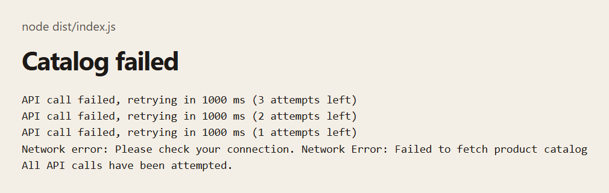

# Promises and Error Handling Challenge

A Node program that loads a product catalog, then reviews for each product, then a sales report.

## Description

The data is simulated with `setTimeout` and `Math.random()`. There is no web page. These screenshots are console output from `node dist/index.js`.

Each simulated call waits, then succeeds about 4 times out of 5. The catalog and the sales report wait 1 second. Reviews wait 1.5 seconds. A catalog failure is a `NetworkError`. A reviews or sales failure is a `DataError`.

`retryPromise` tries a call again up to 3 times, waiting 1000 ms between tries. The wait does not get longer. The log says `1 attempts left` on the last retry. If the fourth try fails, the error reaches the `catch` at the end of the chain. `finally` always prints `All API calls have been attempted.`

Reviews for every product are requested together with `Promise.all`. Both products receive the same three reviews. The requested product id is used in the error message, not in the successful review list. If the catalog fails, reviews and the sales report are skipped. If reviews fail after the retries, the sales report is skipped too.

A `DataError` uses the same retry, then the catch prints `Data error: API did not return data.` followed by the error message. Review failures say `Failed to fetch reviews for product ID 1` (or `2`). A sales failure says `Failed to fetch sales report`.

`package.json` has no start script. `lodash` is installed and is not imported by this program. Output changes from run to run because each call succeeds or fails at random.

## Screenshots

### Success

The catalog, both review lists, and the sales report.



### Retry

The catalog failed three times, then the fourth try succeeded and the rest of the chain ran.



### Network error

The catalog failed all four tries. The catch prints the connection message plus the error message. Reviews and the sales report are not printed.



## Getting Started

### Dependencies

* Node.js and npm
* TypeScript, through `npx tsc`

### Installing

```bash
npm install
```

### Executing program

```bash
npx tsc
node dist/index.js
```

## Help

Output changes from run to run. A catalog failure after four tries skips reviews and the sales report. `finally` still prints `All API calls have been attempted.`

## Authors

[Mamadou Moussa Balde](https://www.linkedin.com/in/2mb/)

## Version History

* Current local run
    * Success, a catalog retry that recovered, and a catalog failure after four tries were captured

## License

This folder does not include a `LICENSE.md` file.

## Acknowledgments

* [README template](https://gist.github.com/DomPizzie/7a5ff55ffa9081f2de27c315f5018afc)

## Critical Thinking Questions

### Why is it important to handle errors for each individual API call rather than just at the end of the promise chain?

Error handling for each API call enables granular recovery in the event of an error and fault tolerance. If you handle errors only at the end of the chain, a single failure could interrupt the entire sequence, even if subsequent operations could have continued independently or if the failed operation could have been gracefully degraded. Individual error handling provides a precise context for identifying exactly which call failed, enabling more accurate error logging and tailored feedback for the user.

### How does using custom error classes improve debugging and error identification?

Custom error classes allow you to distinguish between different types of errors programmatically (e.g., using `instanceof` or specific custom properties). Instead of relying on parsing generic error message strings (which can be fragile), you can catch specific errors like `NetworkError` or `ValidationError` and handle them accordingly. Furthermore, custom error classes let you attach additional contextual metadata to the error, making debugging much easier by providing a clearer picture of what went wrong.

### When might a retry mechanism be more effective than an immediate failure response?

A retry mechanism is highly effective for transient or temporary errors, such as momentary network instability, rate limiting (HTTP 429), or a brief server overload/timeout (HTTP 503/504). In these scenarios, retrying the request after a short delay (often utilizing exponential backoff) has a high probability of succeeding. Failing immediately would result in a poor and frustrating user experience for issues that often resolve themselves within a few seconds.
